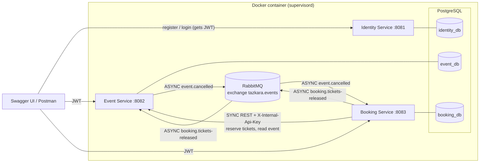

# Tazkara: Event Ticketing Backend

Tazkara (Arabic for "ticket") lets organizers of concerts, workshops and conferences sell tickets online,
without overselling and without unpaid reservations blocking seats forever. This repository is the backend MVP:
three Spring Boot microservices, PostgreSQL and RabbitMQ, all started by **one command** in **one container**.

| Service | Responsibility | Port | Swagger UI |
|---|---|---|---|
| Identity | Registration, login (the only service that issues JWTs), profile | 8081 | http://localhost:8081/swagger-ui.html |
| Event | Events and ticket types, publish, cancel, public browsing, ticket availability | 8082 | http://localhost:8082/swagger-ui.html |
| Booking | Bookings, payment, hold expiry, cancellation and refunds, sales, CSV export, notifications | 8083 | http://localhost:8083/swagger-ui.html |

Tech stack: Java 21, Spring Boot 4.1, Spring Data JPA/Hibernate, Spring Security + JJWT 0.12 (HS256), Spring AMQP (RabbitMQ),
PostgreSQL 14, springdoc-openapi 3.1, Lombok, Maven multi-module, Docker (multi-stage) + supervisord.

---

## 1. Architecture



* Each service owns its own database (and its own DB user); no service reads another service's tables.
* Every service validates JWTs locally with the shared secret; none calls Identity per request.
* Maven modules: `common` (shared error format, JWT validation, security setup, paging, OpenAPI, outbox and RabbitMQ
  topology), `identity-service`, `event-service`, `booking-service`. `mvn clean package` builds everything.

Each service is layered as `controller` (thin REST controllers) + `dto` (request/response records) -> `service`
(use cases, transactions) -> `domain` (entities with the business rules) -> `repository` (Spring Data JPA).
Around them: `config` (Spring configuration, demo data), `exception` (the service's error codes), and where needed
`messaging` (RabbitMQ listeners), `client` (Booking's REST client for the Event Service) and `notification` (Booking's listeners).

---

## 2. How to run

Requirements: Docker Desktop (or Docker Engine + Compose v2). No local Java or Maven needed.

```bash
docker compose up --build
```

The first start takes a few minutes (Maven build inside Docker, then database initialisation). The services are ready
when the log shows `Started ...Application` three times, or when `docker compose ps` shows the container as `healthy`.
Add `-d` to run in the background, then check it:

```bash
docker compose ps                              # wait for (healthy)
curl http://localhost:8081/actuator/health     # {"status":"UP"}, same for 8082 and 8083
docker compose logs -f tazkara                 # all logs: postgres, rabbitmq and the three services
```

On Windows PowerShell use `curl.exe` (plain `curl` is an alias for `Invoke-WebRequest`).

* Data survives restarts (`docker compose down` + `up`) in the named volume `tazkara-data`.
* Reset everything: `docker compose down -v`. Do this if the volume was created by an older version of the schema
  (Hibernate `update` cannot change existing column types, e.g. the service fails with `operator does not exist: uuid = bigint`).
* Only ports 8081, 8082 and 8083 are exposed. PostgreSQL and RabbitMQ listen on 127.0.0.1 inside the container.
* All configuration comes from environment variables (see `docker-compose.yml`). The values there are **dev-only
  defaults** so a fresh clone runs; set `JWT_SECRET`, `INTERNAL_API_KEY`, the DB passwords and `RABBITMQ_PASSWORD`
  to real secrets in any other environment (for example in a `.env` file, which is git-ignored).

Useful variables: `JWT_EXPIRATION` (default `30m`), `BOOKING_HOLD_DURATION` (default `10m`),
`BOOKING_EXPIRY_JOB_INTERVAL` (default `PT30S`), `DEMO_DATA_ENABLED` (default `true`).

### Running without Docker

Needs Java 21, Maven, a local PostgreSQL with the three databases and a local RabbitMQ. Each service reads a `.env` file
from its own folder or the project root (`spring.config.import` in `application.properties`), so put the DB URLs, users and
passwords, `JWT_SECRET`, `INTERNAL_API_KEY` and `RABBITMQ_PASSWORD` there, then:

```bash
mvn clean package
java -jar identity-service/target/identity-service.jar   # likewise event-service and booking-service
```

### Running several processes in one container

The assignment requires one container for everything. The image installs PostgreSQL, RabbitMQ and supervisord
on top of a Java 21 runtime. `docker/entrypoint.sh` initialises the PostgreSQL cluster on the first start (three
databases, three users), writes the RabbitMQ config and then `exec`s **supervisord**, which runs and restarts
postgres, rabbitmq and the three JVMs and sends all their logs to the container log. Each service is started by
`docker/run-service.sh`, which waits until PostgreSQL (and RabbitMQ for event/booking) accept connections.

---

## 3. Demo data and main-flow walkthrough

Created automatically on the first start:

| Role | Email | Password |
|---|---|---|
| Organizer | `organizer@tazkara.com` | `Organizer123` |
| Attendee | `attendee@tazkara.com` | `Attendee123` |

Plus one **published** event "Tazkara Launch Concert" (Roman Theatre, Amman, 30 days after first start) with ticket types
Standard (25.00 JOD, 200 tickets) and VIP (75.00 JOD, 20 tickets).

The demo event belongs to the user id in `DEMO_ORGANIZER_ID` (default `1`). The Identity Service creates the organizer
first, so on an empty database it gets id 1; if the ids ever differ it logs a warning. Set `DEMO_DATA_ENABLED=false` to skip
all demo data. Created by `DemoDataInitializer` (identity) and `DemoEventInitializer` (event).

In Swagger UI: call login on port 8081, copy `accessToken`, click **Authorize** on the 8082/8083 Swagger pages and paste it.

Walkthrough with curl (bash):

```bash
# 1. Log in as attendee and organizer
ATT=$(curl -s localhost:8081/api/auth/login -H 'Content-Type: application/json' \
  -d '{"email":"attendee@tazkara.com","password":"Attendee123"}' | jq -r .accessToken)
ORG=$(curl -s localhost:8081/api/auth/login -H 'Content-Type: application/json' \
  -d '{"email":"organizer@tazkara.com","password":"Organizer123"}' | jq -r .accessToken)

# 2. Browse events (public) and pick ticket type ids
curl -s 'localhost:8082/api/events?city=amman' | jq

# 3. Book 2 Standard + 1 VIP -> PENDING_PAYMENT with a reference and holdExpiresAt
curl -s localhost:8083/api/bookings -H "Authorization: Bearer $ATT" -H 'Content-Type: application/json' \
  -d '{"eventId":1,"items":[{"ticketTypeId":1,"quantity":2},{"ticketTypeId":2,"quantity":1}]}' | jq

# 4. Pay it (use the reference from step 3) -> CONFIRMED, the log shows the [EMAIL] notification
curl -s localhost:8083/api/bookings/TZK-XXXXXXXX/payment -H "Authorization: Bearer $ATT" \
  -H 'Content-Type: application/json' -d '{"paymentMethod":"CARD"}' | jq

# 5. Organizer: sales summary and CSV export
curl -s localhost:8083/api/organizer/events/1/sales -H "Authorization: Bearer $ORG" | jq
curl -s -OJ localhost:8083/api/organizer/events/1/bookings/export -H "Authorization: Bearer $ORG"

# 6. Organizer cancels the event -> bookings become CANCELLED (EVENT_CANCELLED) with a full refund
curl -s -X POST localhost:8082/api/events/1/cancel -H "Authorization: Bearer $ORG" | jq
curl -s localhost:8083/api/bookings -H "Authorization: Bearer $ATT" | jq
```

### API overview

| Story | Method and path | Who |
|---|---|---|
| US-01 | `POST /api/auth/register` (8081) | public |
| US-02 | `POST /api/auth/login` (8081) | public |
| US-03 | `GET`/`PUT /api/users/me` (8081) | logged in |
| US-04 | `POST /api/events` (8082) | organizer |
| US-05 | `PUT /api/events/{id}` (8082) | owner organizer |
| US-06 | `POST /api/events/{id}/publish` (8082) | owner organizer |
| US-07 | `GET /api/events?city=&from=&to=&keyword=&page=&size=`, `GET /api/events/{id}` (8082) | public |
| US-08 | `GET /api/organizer/events?status=`, `GET /api/organizer/events/{id}` (8082) | organizer |
| US-09 | `POST /api/events/{id}/cancel` (8082) | owner organizer |
| US-10 | `POST /api/bookings` (8083) | attendee |
| US-11 | `POST /api/bookings/{reference}/payment` (8083) | owner attendee |
| US-12 | background job in the Booking Service | system |
| US-13 | `GET /api/bookings?status=`, `GET /api/bookings/{reference}` (8083) | owner attendee |
| US-14 | `POST /api/bookings/{reference}/cancel` (8083) | owner attendee |
| US-15 | `GET /api/organizer/events/{id}/bookings?status=`, `GET /api/organizer/events/{id}/sales` (8083) | owner organizer |
| US-16 | `GET /api/organizer/events/{id}/bookings/export` (8083) | owner organizer |
| US-17 | domain event -> `NotificationListener` (log line `[EMAIL] to=... subject=... message=...`) | system |

Every list is paginated with `page` (default 0) and `size` (default 20, max 100) and returns
`{content, page, size, totalElements, totalPages, last}`.

### Error format

All errors of all services, including 401/403 from the security layer, look like:

```json
{
  "timestamp": "2026-10-21T10:15:30Z",
  "status": 409,
  "error": "Conflict",
  "code": "TICKETS_UNAVAILABLE",
  "message": "Not enough tickets available for 'VIP' (requested 3, available 1)",
  "path": "/api/bookings",
  "fieldErrors": [ { "field": "items[0].quantity", "message": "must be greater than or equal to 1" } ]
}
```

400 invalid input (`VALIDATION_FAILED`, `MALFORMED_REQUEST`), 401 (`UNAUTHORIZED`, `TOKEN_EXPIRED`, `TOKEN_INVALID`,
`INVALID_CREDENTIALS`), 403 `ACCESS_DENIED`, 404 `*_NOT_FOUND`, 409 conflicts with the current state
(`EMAIL_ALREADY_REGISTERED`, `TICKETS_UNAVAILABLE`, `BOOKING_NOT_PENDING`, `EVENT_NOT_EDITABLE`, `INVALID_STATUS_TRANSITION`...),
422 business-rule violations (`EVENT_START_TOO_SOON`, `TICKET_LIMIT_EXCEEDED`, `HOLD_EXPIRED`, `CANCELLATION_NOT_ALLOWED`,
`EVENT_NOT_BOOKABLE`...), 503 `EVENT_SERVICE_UNAVAILABLE`. Stack traces are never returned.

---

## 4. Design decisions

### Synchronous vs asynchronous communication

| Interaction | Style | Why |
|---|---|---|
| Booking -> Event: reserve tickets (`POST /internal/events/{id}/reservations`) | **Sync REST** | The attendee needs an immediate yes/no and the prices. The answer decides whether the booking exists. |
| Booking -> Event: read event (`GET /internal/events/{id}`) for payment and organizer ownership | **Sync REST** | Needs the current truth (is the event cancelled? who owns it?) to answer the request. |
| Event -> Booking: `event.cancelled` | **Async (RabbitMQ)** | The organizer should not wait for (or fail because of) the Booking Service. Cancelling hundreds of bookings is background work. |
| Booking -> Event: `booking.tickets-released` (expiry, attendee cancel, compensation) | **Async (RabbitMQ)** | Nobody waits for it, it must survive the Event Service being down, and it is idempotent. |
| Booking -> notification listeners | In-process **Pub/Sub** (Spring events) | US-17: booking code must not depend on notification code. |

### How Event and Booking cooperate on inventory (never oversell)

The **Event Service owns availability**: each ticket type has `quantity` and `reserved` (held + sold);
available = quantity - reserved. A booking is placed like this:

1. Booking Service takes a PostgreSQL advisory lock on (attendee, event) and checks the **6-ticket limit** against the
   attendee's PENDING_PAYMENT and CONFIRMED bookings. Two parallel requests of the same attendee are serialised, so the
   limit cannot be bypassed by racing.
2. It generates the booking reference and calls the Event Service to **reserve**. The Event Service locks the event
   row (`SELECT ... FOR UPDATE`), the `Event` aggregate checks **every** line first and only then increments the
   counters (**all or nothing**), and records a `TicketReservation` for the reference. A DB check constraint
   `reserved <= quantity` is the last safety net.
3. The Booking Service stores the booking with the **prices returned by the Event Service** and computes the total.

**Overselling technique:** pessimistic row lock on the event during reservation. If two attendees ask for the last
ticket at the same time, the second transaction waits for the first, then sees 0 available and gets
`409 TICKETS_UNAVAILABLE`. Exactly one succeeds.

Releases (expiry, attendee cancellation) go back to the Event Service as `booking.tickets-released` messages; the
Event Service marks the reservation RELEASED and decrements the counters once, so duplicates are harmless.

### Partial failures

| Failure | What happens |
|---|---|
| Event Service down when booking | `503 EVENT_SERVICE_UNAVAILABLE`, no booking is created. Because a timeout leaves the outcome unknown, a compensating release is queued anyway. |
| Reservation succeeded but the booking could not be saved | A `TransactionSynchronization` sees the rollback and queues a compensating release (own transaction), so the tickets are freed. |
| Release arrives before (or instead of) the reservation | The Event Service stores a RELEASED "tombstone" for that reference; a late reservation with it is refused, so tickets never leak. |
| RabbitMQ down | Messages are written to an **outbox table** in the same transaction as the business change and published later by `OutboxRelay` (with publisher confirms). Nothing is lost; delivery is at-least-once and consumers are idempotent. |
| Booking Service down when an event is cancelled (US-09) | The event is still cancelled immediately (not bookable, not visible). `event.cancelled` waits in the durable queue and the bookings are cancelled and refunded when the service is back. Meanwhile payments of that event are refused, because payment checks the event status synchronously. |
| A consumer keeps failing | 5 retries with exponential back-off, then the message goes to a dead-letter queue (`*.dlq`) for inspection. |
| Publisher connects to RabbitMQ before the consumer service | Both services declare the **whole** topology (exchanges, all queues, bindings, DLQs) from `MessagingTopology` on connect, so a queue always exists before the first message is published; otherwise RabbitMQ would silently drop unroutable messages. |

### Service-to-service security

Internal endpoints live under `/internal/**` and require the header `X-Internal-Api-Key` with a shared secret from the
`INTERNAL_API_KEY` environment variable (constant-time comparison). They need the role `INTERNAL_SERVICE`, which only this
filter grants, so an attendee's JWT can never call `reserve` directly. A shared key was chosen over forwarding the user
token because the calls are made on behalf of the system (for example the reservation must not be callable by users,
and future background calls have no user token). Internal endpoints are hidden from Swagger.

### Expiry job and concurrency (US-12, multi-threading)

`BookingExpiryJob` is a `@Scheduled(fixedDelay)` task running on the Spring scheduler thread pool
(threads `booking-scheduler-*`), never on an HTTP thread; fixed delay means runs never overlap. It loads the ids of
overdue PENDING_PAYMENT bookings and expires each one in its own short transaction (`BookingExpiryService`, `REQUIRES_NEW`).

Job vs payment on the same booking: both take a **row lock** (`SELECT ... FOR UPDATE`) and re-check the status inside it.
Whoever locks first wins; the other then sees the new status (`CONFIRMED`, so the job skips it; or `EXPIRED`, so the payment
gets `409 BOOKING_NOT_PENDING`). Payment is also refused once `holdExpiresAt` has passed even if the job has not run yet
(`422 HOLD_EXPIRED`). `@Version` columns add optimistic locking as an extra guard.

Other threads: the outbox relay runs on the same scheduler pool; notifications run on the `notification-*` executor;
RabbitMQ consumers run on listener container threads.

### Security (JWT)

* Identity issues HS256 tokens signed with `JWT_SECRET` (jjwt refuses secrets under 256 bits). Claims: `sub` (user id),
  `email`, `role`, `iat`, `exp`, `iss`. Expiry 30 minutes, configurable with `JWT_EXPIRATION`.
* Each service validates signature, issuer and expiry locally on every request. Missing or bad token -> 401, valid token
  without the role -> 403, both in the common JSON format.
* Roles with `@PreAuthorize` (only organizers manage events, only attendees book). Ownership checked in the services: another
  user's event or booking answers **404**, so knowing an id reveals nothing.
* BCrypt password hashes; passwords and tokens are never logged or returned. Wrong email and wrong password return the same
  `401 INVALID_CREDENTIALS` (and the same timing, thanks to a dummy hash check).
* Stateless (no HTTP session). **CSRF is disabled** because CSRF exploits credentials the browser sends automatically
  (cookies); this API uses no cookies and requires an explicit `Authorization` header that a cross-site form cannot add.
* Public endpoints only: register, login, event browsing and details, OpenAPI docs, health.

---

## 5. Patterns used

| Pattern | Where | Why |
|---|---|---|
| **Builder** | `common/.../ApiError.Builder` | The error has many optional parts (field errors, path, code); the builder makes constructing it readable and consistent in every handler. |
| **Factory** | `UserFactory` (identity), `Event.createDraft`, `Booking.place` | One place knows how to create a valid object: the user factory hashes the password and builds the role-specific user; the static factories enforce creation rules (DRAFT status, server-computed total, free = confirmed). |
| **Singleton** | `BookingReferenceGenerator` (Spring singleton scope) | One shared, thread-safe `SecureRandom` for the whole service instead of seeding a new one per request. All Spring beans are singletons managed by the container. |
| **Observer / Pub-Sub** | `Booking` registers `BookingStatusChangedEvent` (via `AbstractAggregateRoot`); `NotificationListener` and `BookingAuditListener` subscribe | Booking code knows nothing about notifications; the audit listener was added without changing booking code. RabbitMQ is the same idea between services. |
| **Strategy** (bonus) | `RefundPolicy` with `FullRefundPolicy`, `HalfRefundPolicy`, `NoCancellationPolicy`, chosen by `RefundPolicyResolver` | Refund rules are interchangeable; adding a rule is one new class. |
| **MVC** | `@RestController` (controller) -> services/domain (model) -> JSON DTOs (view) | Thin controllers, no entity ever returned. |
| **Transactional Outbox** | `common/.../messaging` | Business change and message are committed atomically. |

DDD: aggregates `User`, `Event` (with `TicketType`), `Booking`; value objects `EmailAddress`, `EventDetails`,
`TicketTypeSpec`, `BookingReference`, `BookingLine`; status enums with explicit allowed transitions
(`EventStatus.canTransitionTo`, `BookingStatus.canTransitionTo`) enforced inside the aggregates.

Lightly required topics: **Files and I/O** in `BookingCsvExporter` (`ByteArrayOutputStream` -> `OutputStreamWriter` UTF-8 ->
`BufferedWriter`, RFC 4180 escaping in `CsvWriter`); **multi-threading** in the expiry job/row locks described above;
**Maven** multi-module build.

---

## 6. Assumptions

* Single currency: **JOD** (Jordanian Dinar). Money is `BigDecimal` with 2 decimals; 50% refunds are rounded half-up to the cent.
* All times are UTC `Instant`s (ISO-8601, e.g. `2026-12-20T18:00:00Z`). The browse filters `from`/`to` are calendar dates in UTC, both inclusive.
* The 6-ticket limit counts all PENDING_PAYMENT and CONFIRMED bookings of the attendee for that event (an unpaid booking counts until it expires or is cancelled).
* A booking may contain up to 5 lines; lines for the same ticket type are merged.
* Organizer accounts must have an organization name; for attendees an organization name is ignored.
* Passwords: 8 to 72 characters (BCrypt only uses the first 72 bytes), at least one letter and one digit.
* Unknown JSON fields are rejected (400), so trying to change `email` or `role` in the profile update is an explicit error.
* Editing a draft replaces all its details and ticket types (PUT semantics).
* Ownership failures answer 404 (not 403), to avoid revealing which ids exist. Role failures answer 403.
* Cancelling a PENDING_PAYMENT booking records a refund of 0.00. Event cancellation refunds confirmed bookings 100%.
* Attendees are notified on confirmed, expired and cancelled (including cancellations caused by the event).
* The sales summary's `remaining` = quantity - sold - held, computed from the Booking Service's own bookings.
* The CSV contains one row per ticket type of each confirmed booking; values starting with `= + - @` are prefixed with `'` to prevent spreadsheet formula injection.
* Demo users are created only if their email is not registered yet, and the demo event only if the event database is
  empty; the demo event starts 30 days after the first start.

## 7. Known limitations

* Hibernate generates the schema (`spring.jpa.hibernate.ddl-auto=update`). Fine for this MVP, **not a production practice**:
  use Flyway or Liquibase migrations. It also cannot migrate changed column types, so an old `tazkara-data` volume must be reset.
* No automated tests yet (`mvn clean test` runs nothing).
* One instance per service. The advisory/row locks work across instances, but the outbox relay would need `SELECT ... FOR UPDATE SKIP LOCKED` and the scheduled job a distributed lock (e.g. ShedLock) to run several instances.
* Shared HMAC secret: every service that validates tokens could also sign them. RS256 (private key only in Identity) would be the next step. No refresh tokens or token revocation.
* No API gateway or service discovery (out of scope); clients call each service on its own port.
* Payments, refunds and emails are simulated (refunds are only recorded, emails are log lines).
* If an attendee cancels a confirmed booking after the organizer cancelled the event but before the `event.cancelled` message is processed, the attendee policy (not the 100% event refund) is applied.
* Dead-lettered messages are not replayed automatically.
* All processes share one container because the assignment requires it; in production each would be its own container.

## 8. Project structure

```
tazkara/
├── pom.xml                      parent POM (Java 21, Spring Boot 4.1, the four modules)
├── common/                      com.tazkara.common
│   ├── error/                   ApiError (+ Builder), ApiExceptionHandler, ErrorCode, CommonErrorCode, DomainException
│   ├── security/                JWT validation, InternalApiKeyFilter, StatelessSecurity, Role, AuthenticatedUser
│   ├── web/                     PageResponse, Paging, CommonWebConfiguration (OpenAPI, clock)
│   └── messaging/               outbox (OutboxMessage, OutboxPublisher, OutboxRelay), MessagingTopology, message records
├── identity-service/            com.tazkara.identity: users, registration, login, profile
│   └── config/ controller/ domain/ dto/ exception/ repository/ service/
├── event-service/               com.tazkara.event: events, ticket types, reservations, public browsing
│   └── config/ controller/ domain/ dto/ exception/ messaging/ repository/ service/
├── booking-service/             com.tazkara.booking: bookings, payment, expiry job, refunds, sales, CSV, notifications
│   └── client/ config/ controller/ domain/ (refund/) dto/ exception/ messaging/ notification/ repository/ service/ (csv/)
├── docker/                      entrypoint.sh, run-service.sh, supervisord.conf
├── Dockerfile                   multi-stage build (Maven -> JRE 21 + PostgreSQL + RabbitMQ + supervisord)
├── docker-compose.yml           one service, ports 8081-8083, volume tazkara-data, dev-only default secrets
├── .dockerignore
└── .env                         local secrets for running without Docker (git-ignored)
```
